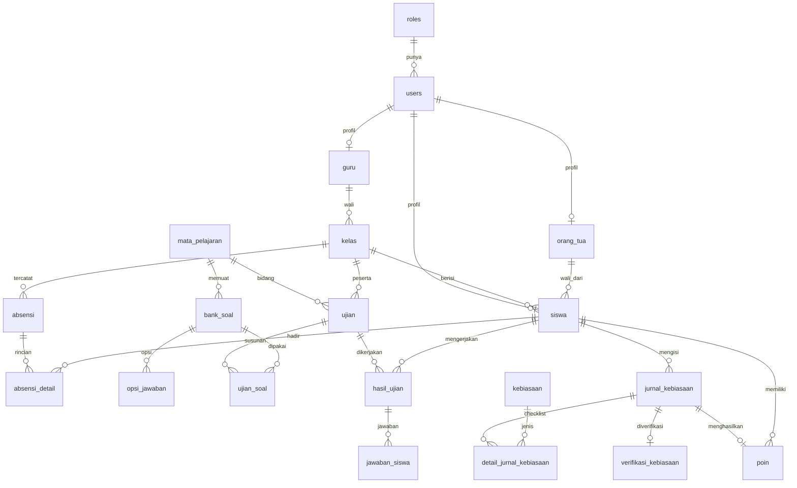

# Sistem Informasi Akademik & Monitoring Kebiasaan Siswa SD

Aplikasi web untuk Sekolah Dasar Negeri yang menggabungkan **absensi harian**, **latihan/ujian TKA online**, dan **monitoring Gerakan 7 Kebiasaan Anak Indonesia Hebat**. Dibuat 100% native (tanpa framework) untuk KKP.

## Daftar Isi
1. [Fitur](#1-fitur)
2. [Tech Stack](#2-tech-stack)
3. [Panduan Instalasi dari Awal (Windows + XAMPP)](#3-panduan-instalasi-dari-awal-windows--xampp)
4. [Akun Demo](#4-akun-demo)
5. [Tur Singkat: Mencoba Semua Fitur](#5-tur-singkat-mencoba-semua-fitur)
6. [Struktur Folder](#6-struktur-folder)
7. [Struktur Database](#7-struktur-database)
8. [Alur Sistem](#8-alur-sistem)
9. [Keamanan](#9-keamanan)
10. [Asumsi Implementasi](#10-asumsi-implementasi)
11. [Testing](#11-testing)
12. [Git & GitHub](#12-git--github)
13. [Masalah Umum](#13-masalah-umum)

---

## 1. Fitur

| Role | Fitur |
|---|---|
| **Admin / Guru** | Dashboard ringkasan; Data Master Siswa, Guru (admin saja), Kelas, Mata Pelajaran (CRUD + pencarian); Input absensi H/I/S/A; Rekap absensi harian/bulanan/semester; Bank soal (gambar pendukung, kunci, pembahasan); Jadwal ujian; Hasil ujian; Analisis butir soal; Verifikasi jurnal 7 kebiasaan + apresiasi; Laporan absensi, TKA, kebiasaan, dan terpadu (Export Excel/CSV + Cetak PDF) |
| **Siswa** | Dashboard; Rekap kehadiran pribadi; Ujian TKA dengan timer; Nilai + pembahasan; Checklist harian 7 kebiasaan; Poin, badge, progress, dan grafik |
| **Orang Tua** | Dashboard anak; Laporan absensi bulanan (bisa dicetak); Nilai TKA; Grafik kebiasaan anak |

Grafik (donat, batang, garis) digambar dengan **SVG + JavaScript Vanilla** buatan sendiri (`assets/js/grafik.js`), jadi **tidak memakai library eksternal apa pun**.

## 2. Tech Stack

HTML5, CSS3 (CSS Variables, Flexbox, Grid, Media Query), JavaScript Vanilla, PHP Native 8.2+, MySQL/MariaDB, PDO, Apache (XAMPP). Tanpa Laravel/CodeIgniter, React/Vue, Bootstrap/Tailwind, ataupun jQuery.

## 3. Panduan Instalasi dari Awal (Windows + XAMPP)

### Langkah 1 - Pasang XAMPP
1. Unduh XAMPP dari <https://www.apachefriends.org> dengan **PHP 8.2 atau lebih baru**.
2. Pasang dengan pengaturan bawaan (biasanya ke `C:\xampp`). Komponen yang wajib dicentang: **Apache**, **MySQL**, **PHP**, **phpMyAdmin**.
3. Buka **XAMPP Control Panel**, lalu klik **Start** pada **Apache** dan **MySQL**. Keduanya harus berwarna hijau.

### Langkah 2 - Taruh folder project
1. Ekstrak file ZIP project, sehingga Anda punya folder bernama `kkp-sd`.
2. Salin seluruh folder `kkp-sd` ke `C:\xampp\htdocs\`.
3. Hasil akhirnya: `C:\xampp\htdocs\kkp-sd\index.php` (pastikan tidak ada folder ganda seperti `kkp-sd\kkp-sd`).

### Langkah 3 - Buat database dan isi data
1. Buka browser, lalu akses <http://localhost/phpmyadmin>.
2. Klik tab **Import** di bagian atas.
3. Klik **Choose File**, pilih `C:\xampp\htdocs\kkp-sd\database\database.sql`.
4. Gulir ke bawah, klik **Import** (atau **Go**).
5. Tunggu muncul tanda centang hijau. Di sisi kiri akan ada database baru bernama **`kkp_sd`** berisi 21 tabel beserta data dummy.

> File `database.sql` sudah memuat perintah `CREATE DATABASE`, jadi Anda tidak perlu membuat database manual.

### Langkah 4 - Cek konfigurasi database
Buka `config/constants.php` dengan editor teks (Notepad, VS Code). Bagian yang relevan:

```php
define('DB_HOST', '127.0.0.1');
define('DB_NAME', 'kkp_sd');
define('DB_USER', 'root');
define('DB_PASS', '');   // XAMPP bawaan: password kosong
```

Jika MySQL Anda memakai password, isi `DB_PASS`. Jika tidak, **tidak ada yang perlu diubah**.

### Langkah 5 - Jalankan aplikasi
Buka <http://localhost/kkp-sd/> di browser. Anda akan diarahkan ke halaman login. Masuk memakai [akun demo](#4-akun-demo).

> Alamat dasar (`/kkp-sd`) dideteksi otomatis, jadi nama folder boleh diganti tanpa mengubah kode.

## 4. Akun Demo

Semua akun memakai password **`password`**. Pada halaman login pilih peran terlebih dahulu.

| Peran | Pilihan di login | Username | Keterangan |
|---|---|---|---|
| Admin | Guru / Admin | `197501010001` | Bisa membuka menu **Guru** (Data Master) |
| Guru | Guru / Admin | `198001010001` | Wali kelas 4A |
| Guru | Guru / Admin | `198505152001` | Wali kelas 5A |
| Guru | Guru / Admin | `199003202002` | Wali kelas 6A |
| Siswa | Siswa | `0012345678` | Ahmad Fauzi, kelas 4A (NISN `0012345678` sampai `0012345692`) |
| Orang Tua | Orang Tua | `0012345678` | Orang tua Ahmad Fauzi **dan** Nabila Fauzi (kelas 5A): ada pilihan 2 anak |

Login orang tua memakai **NISN anak** (anak pertama yang terhubung) + password orang tua.

Data dummy: 3 kelas (4A, 5A, 6A), 15 siswa, 4 mata pelajaran, 20 soal, 6 ujian, absensi Agustus-Oktober 2026, dan jurnal kebiasaan 28 September-12 Oktober 2026. Ujian "Latihan TKA ..." dijadwalkan terbuka sekitar 60 hari sejak data diimpor; setelah itu ubah jadwalnya di menu **TKA > Ujian**.

## 5. Tur Singkat: Mencoba Semua Fitur

Ikuti urutan ini agar semua alur tersambung:

1. **Guru** login (`198001010001`) > **Absensi Kelas > Input Absensi** > pilih kelas 4A, tanggal hari ini, ubah beberapa siswa menjadi Sakit/Izin > **Simpan**. Muncul pesan persentase hadir. Lihat hasilnya di **Rekap Absensi** (coba jenis Harian, Bulanan, Semester).
2. **Siswa** login (`0012345678`) > **7 Kebiasaan > Checklist Harian** > centang beberapa kebiasaan > **Kirim**. Status jurnal: *Menunggu*.
3. **Guru** > **7 Kebiasaan > Verifikasi** > klik **Periksa** pada jurnal Ahmad > pilih *Setujui*, isi apresiasi > **Simpan**. Poin bertambah sebanyak kebiasaan yang diceklis.
4. **Siswa** > **Poin & Badge**: poin dan badge bertambah. **History** menampilkan apresiasi guru.
5. **Siswa** > **Ujian TKA > Ujian Aktif** > *Latihan TKA Matematika* > **Detail > Mulai Ujian**. Kerjakan soal (jawaban tersimpan otomatis), tandai ragu-ragu, lalu **Kirim Jawaban**. Nilai dan pembahasan langsung tampil. Mencoba mengerjakan ulang akan ditolak ("Anda sudah mengerjakan ujian").
6. **Guru** > **TKA > Hasil Ujian** dan **Analisis Soal** untuk melihat nilai kelas dan tingkat kesukaran tiap soal.
7. **Orang Tua** login (`0012345678`) > pilih anak, lihat Absensi, Nilai TKA, dan Kebiasaan.
8. **Guru** > **Laporan** > buka salah satu laporan > **Export Excel (CSV)** atau **Cetak / PDF** (di jendela cetak pilih *Save as PDF*).

## 6. Struktur Folder

```text
kkp-sd/
├── config/
│   ├── constants.php        # pengaturan aplikasi + database
│   └── database.php         # koneksi PDO: db()
├── includes/
│   ├── auth.php             # session, login/role, flash, CSRF, helper e() dan url()
│   ├── fungsi.php           # fungsi bersama: rekap absensi, poin/badge, auto-grading, periode, CSV
│   ├── header.php  navbar.php  sidebar.php  footer.php   # kerangka halaman
├── assets/
│   ├── css/style.css        # seluruh gaya (CSS Variables)
│   ├── js/app.js            # menu mobile, konfirmasi hapus, filter periode, cetak
│   ├── js/grafik.js         # grafik SVG native
│   ├── js/ujian.js          # timer & navigasi soal
│   ├── images/  icons/
├── auth/                    # login.php, proses-login.php, logout.php
├── guru/                    # area Admin/Guru (data master, absensi, TKA, jurnal)
├── siswa/                   # area Siswa (dashboard, ujian, kebiasaan, badge)
├── orangtua/                # area Orang Tua
├── laporan/                 # 4 laporan + export
├── uploads/soal/            # gambar soal (PHP tidak boleh dijalankan di sini)
├── database/database.sql    # skema + data dummy
└── index.php
```

Penyesuaian dari struktur awal: folder `admin/` digabung ke `guru/` karena Admin dan Guru memakai menu yang sama (hanya Data Guru yang khusus Admin, dijaga di sisi server), dan folder `uploads/` berada di root agar mudah diatur izin aksesnya.

## 7. Struktur Database

Database `kkp_sd` (21 tabel, InnoDB, utf8mb4, `snake_case`, 3NF).



Keputusan desain (agar tidak ada data redundan):
- **Jumlah soal ujian** tidak disimpan, dihitung dari `ujian_soal`.
- **Benar/salah per jawaban** tidak disimpan, dihitung dengan membandingkan `jawaban_siswa.jawaban` ke `bank_soal.kunci_jawaban`. Hasil akhir (benar, salah, nilai) disimpan di `hasil_ujian`.
- **Badge** tidak disalin per siswa, diraih otomatis bila total poin >= `badge.minimal_poin`.
- `UNIQUE (ujian_id, siswa_id)` pada `hasil_ujian` menjamin ujian hanya dikerjakan sekali; `UNIQUE (kelas_id, tanggal)` pada `absensi` mencegah absensi ganda; `UNIQUE (siswa_id, tanggal)` pada `jurnal_kebiasaan` membatasi satu jurnal per hari.

## 8. Alur Sistem

- **Login:** pilih peran > isi username + password > `password_verify()` > session > diarahkan ke dashboard sesuai role. Gagal: kembali ke login.
- **Absensi:** Guru pilih kelas dan tanggal > isi H/I/S/A > simpan (boleh disimpan ulang untuk koreksi) > persentase = Hadir / Total Hari x 100 > rekap.
- **TKA:** Siswa pilih ujian aktif > informasi ujian > **Mulai** (waktu dicatat di server) > soal + countdown > jawaban tersimpan otomatis > **Kirim** atau waktu habis > auto-grading (Nilai = Benar / Jumlah Soal x 100) > nilai + pembahasan.
- **7 Kebiasaan:** Siswa checklist > jurnal *Menunggu* > Guru verifikasi > *Disetujui*: poin dicatat, badge/progress/grafik ikut berubah. *Ditolak*: siswa membaca catatan lalu memperbaiki dan kirim ulang.
- **Laporan:** absensi + TKA + kebiasaan digabung di Laporan Terpadu > Export CSV (Excel) atau Cetak/PDF.

## 9. Keamanan

- Seluruh query memakai **PDO prepared statements** (`ATTR_EMULATE_PREPARES = false`).
- Password disimpan dengan `password_hash()`, diperiksa dengan `password_verify()`; ID sesi diganti saat login.
- **Otorisasi di backend** pada setiap halaman (`wajib_role()`), bukan sekadar menyembunyikan menu.
- Siswa hanya dapat membuka hasil dan ujian miliknya (dicek lewat `siswa_id` dan kelas); orang tua hanya dapat melihat anak yang terhubung (`pilih_anak()`).
- Waktu ujian **divalidasi di server**: jawaban setelah batas waktu ditolak dan ujian diproses otomatis.
- Token **CSRF** pada semua formulir POST, output di-escape dengan `e()` (cegah XSS).
- Upload gambar soal: divalidasi dengan `getimagesize()`, maksimal 1 MB, nama file diacak, dan eksekusi PHP di folder upload diblokir lewat `.htaccess`.
- Error database tidak ditampilkan ke pengguna (hanya dicatat di log PHP); pesan yang tampil memakai bahasa Indonesia yang mudah dipahami.

## 10. Asumsi Implementasi

Hal berikut tidak dijelaskan di dokumen requirement, sehingga ditetapkan sebagai asumsi:

1. **Login orang tua** memakai NISN anak (anak pertama yang terhubung) + password orang tua. Satu akun orang tua dapat terhubung ke beberapa anak.
2. **Admin dan Guru** memakai antarmuka yang sama; hanya menu *Data Guru* yang khusus Admin.
3. **Export Excel** berupa file **CSV** (native PHP, dapat dibuka di Excel), dan **PDF** lewat fitur cetak browser (*Save as PDF*), agar tidak memerlukan library.
4. **Grafik** digambar dengan SVG + JavaScript sendiri, Chart.js tidak dipakai.
5. **Badge** berdasarkan total poin: 10, 25, 50, 100, 200.
6. **Progress kebiasaan** = kebiasaan yang disetujui / (7 x jumlah hari pengisian jurnal kelas) x 100.
7. **Persentase kehadiran** pada dashboard memakai semester berjalan (Ganjil: Juli-Desember, Genap: Januari-Juni).
8. Jurnal kebiasaan diisi **per hari (hari ini)**, satu jurnal per siswa per hari; jurnal yang sudah disetujui tidak dapat diubah.
9. Soal berupa **pilihan ganda 4 opsi (A-D)**; ujian hanya dapat dikerjakan **sekali** per siswa.

## 11. Testing

Checklist pengujian. Alur sisi server (login, otorisasi, absensi, ujian, jurnal, siswa baru, upload) sudah diuji otomatis saat pengembangan. Tampilan di HP, cetak PDF, dan pembukaan CSV di Excel perlu Anda cek langsung:

- [ ] Login 3 peran berhasil; password salah menampilkan "Login gagal".
- [ ] Siswa membuka `/guru/dashboard.php` > ditolak ("Akses ditolak").
- [ ] Guru biasa membuka `/guru/guru.php` > ditolak; Admin berhasil.
- [ ] Siswa membuka hasil ujian siswa lain (`ujian-hasil.php?id=...`) > ditolak.
- [ ] Orang tua mengganti `?anak=` ke anak orang lain > tetap menampilkan anak miliknya.
- [ ] Absensi tersimpan dan persentase benar; tanggal masa depan ditolak.
- [ ] Ujian: mulai, simpan otomatis, kirim, nilai sesuai kunci, tidak bisa diulang.
- [ ] Ujian dengan waktu habis diproses otomatis ketika halaman dibuka lagi.
- [ ] Jurnal disetujui > poin bertambah; ditolak > poin dihapus.
- [ ] Tambah siswa baru + akun orang tua; NISN ganda ditolak; siswa baru dapat login.
- [ ] Upload file non-gambar ditolak.
- [ ] Export CSV dan cetak PDF dari setiap laporan.
- [ ] Tampilan nyaman di layar HP (menu samping berubah menjadi tombol ikon garis tiga).

## 12. Git & GitHub

Langkah pertama kali (Git sudah terpasang, akun GitHub sudah ada):

```bash
cd C:\xampp\htdocs\kkp-sd
git init
git add .
git commit -m "Versi awal Sistem Informasi Akademik SD"
git branch -M main
git remote add origin https://github.com/USERNAME/kkp-sd.git
git push -u origin main
```

Ganti `USERNAME` dengan nama akun GitHub Anda dan buat repository kosong bernama `kkp-sd` di GitHub terlebih dahulu. File `.gitignore` sudah menyiapkan agar gambar upload tidak ikut ter-commit.

## 13. Masalah Umum

| Gejala | Penyebab & solusi |
|---|---|
| "Koneksi database gagal" | MySQL belum di-Start di XAMPP, atau database `kkp_sd` belum diimpor, atau password di `config/constants.php` salah. |
| Halaman tanpa tampilan (CSS tidak termuat) | Folder tidak berada di `htdocs/kkp-sd` atau ada folder ganda. Pastikan `http://localhost/kkp-sd/assets/css/style.css` terbuka. |
| `404 Not Found` | Apache belum Start, atau alamat salah. Gunakan `http://localhost/kkp-sd/`. |
| Port 80 / 3306 bentrok | Tutup Skype/IIS atau ubah port di XAMPP (Config > Service and Port Settings). |
| Upload gambar soal gagal | Ukuran > 1 MB, atau format bukan JPG/PNG/WEBP/GIF. |
| Siswa tidak melihat ujian | Ujian berstatus Draft, jadwal belum mulai/sudah lewat, atau kelasnya berbeda. Cek di **TKA > Ujian**. |
| Export CSV tampil satu kolom di Excel | File memakai pemisah titik koma (`;`) dan baris `sep=;`; buka lewat Excel > Data > From Text/CSV bila perlu. |
